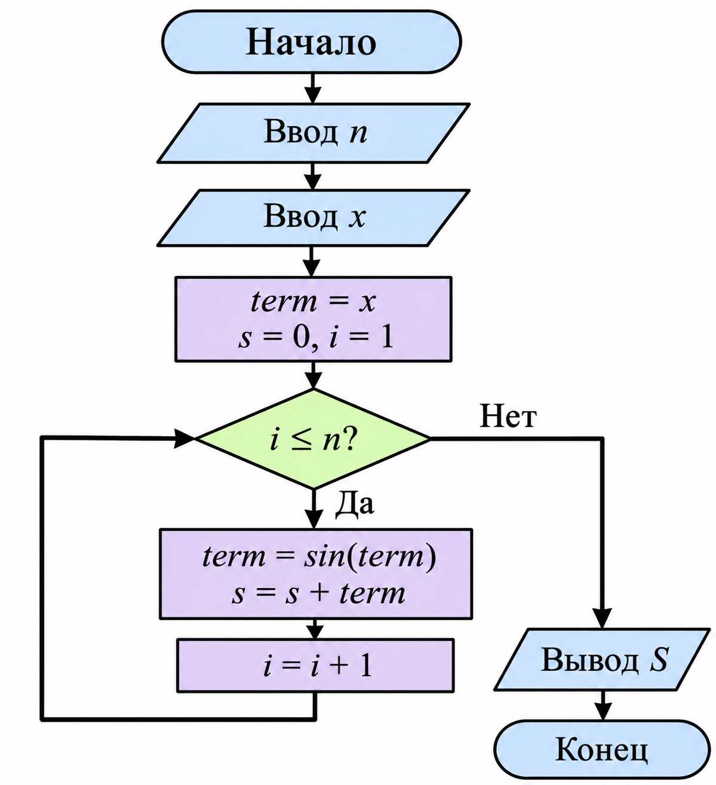

## ДОМАШНЕЕ ЗАДАНИЕ К РАБОТЕ 8

## Условие

Разработать программу на языке C для вычисления суммы вложенных синусов с использованием цикла `for` для заданных натурального числа `n` и действительного числа `x`.

## Математическая формула

\[
S=\sin x+\sin(\sin x)+\ldots+
\underbrace{\sin(\sin(\ldots\sin x))}_{n\ раз}
\]

##  1. Алгоритм и блок-схема

1. Начало программы.
2. Подключение необходимых библиотек и установка русской локали.
3. Объявление переменных:
   - `n` — количество слагаемых;
   - `x` — заданное действительное число;
   - `s` — сумма, первоначальное значение которой равно 0;
   - `term` — промежуточное значение.
4. Ввод натурального числа `n`.
5. Ввод действительного числа `x`.
6. Присваивание переменной `term` значения `x`.
7. Организация цикла `for` от 1 до `n`.
8. Вычисление очередного вложенного синуса: `term = sin(term)`.
9. Добавление полученного значения к сумме: `s = s + term`.
10. Повторение вычислений до достижения `n`.
11. Вывод полученной суммы `s`.
12. Завершение программы.

### Блок-схема

[Открыть блок-схему](images/block_scheme.png)

## 2. Реализация программы

## 3. Результат работы программы

Программа  для вычисления суммы вложенных синусов. Для выполнения вычислений использовался цикл `for`, а для вычисления синуса — математическая функция `sin()`. Программа позволяет получить сумму заданного количества вложенных синусов для введённого значения `x`.

## Информация о разработчике 
                                Запорин Артём, бТИИ-262